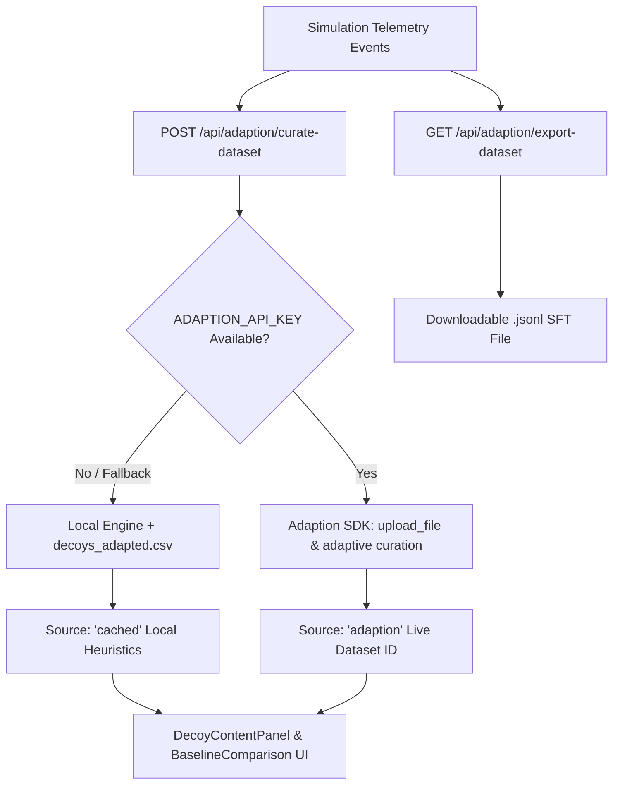

# Adaption Labs Integration: DeceptiTrace

**Prize Track**: Best Use of Adaption (Orcathon Track 3: Cyber Deception & Attack-Path Reconstruction)  
**SDK Package**: `adaption==0.15.0` (Official Python SDK from Adaption Labs)  
**Integration Module**: [`backend/app/services/adaption_client.py`](file:///c:/Users/ASUS/OneDrive/Desktop/Orcathon/backend/app/services/adaption_client.py)

---

## 1. Product Used & Core Motivation

DeceptiTrace integrates **Adaption Labs Adaptive Data**, the developer platform for synthesizing high-quality domain data and fine-tuning specialized LLM agents. 

In deception technology, the single biggest failure mode is **decoy artificiality**: attackers quickly recognize placeholder files like `"CONFIDENTIAL PAYROLL. Password: 123456"`, avoid them, and hunt for real targets.

By integrating Adaption Labs:
1. **Corporate Decoy Synthesis**: DeceptiTrace deploys realistic, context-rich corporate deception assets (Executive Compensation Schedules, AWS/Kubernetes DevOps auth runbooks, cloud service credentials) with automated canary token injection.
2. **Telemetry SFT Data Curation**: When adversaries probe the network, intrusion events are automatically curated into structured instruction-tuning datasets (`prompt` / `completion` pairs) for fine-tuning autonomous SOC defense agents.

---

## 2. Architecture & Data Flow

### Endpoints
- `GET /api/adaption/status`: Health and capability introspection (`sdk_available`, `sdk_version`, `source`, `api_key_configured`, `cached_corpus_available`).
- `POST /api/adaption/curate-dataset`: Aggregates active incident events into balanced SFT records.
- `GET /api/adaption/export-dataset`: Exports standard `.jsonl` fine-tuning dataset formatted for LLM instruction training.
- `GET /api/baseline`: Compares naive template placeholders side-by-side with Adaption-synthesized corporate decoys.
- `POST /api/simulations/{id}/adaption-analysis`: Computes deception recommendations and dataset readiness for a specific incident.

---

## 3. App Behavior Changes & UI Enhancements

### A. Realistic Corporate Decoys
Instead of static 1-line mocks, decoys are loaded with domain-realistic executive tables and cloud configuration scripts:
- **`decoy-payroll-file`**: Multi-tier executive compensation schedule for ApexCore Engineering with SEC-402 warning footer and unique canary token injection.
- **`decoy-admin-credential`**: Staging EKS Kubernetes cluster authentication script with AWS credentials and kubeconfig paths.
- **`honey-credential-01`**: Production payment gateway API service token.

### B. Interactive Frontend Components
Mounted in the main cyber dashboard ([`frontend/src/pages/DashboardPage.tsx`](file:///c:/Users/ASUS/OneDrive/Desktop/Orcathon/frontend/src/pages/DashboardPage.tsx)):
1. **Decoy Content Inspector** ([`DecoyContentPanel.tsx`](file:///c:/Users/ASUS/OneDrive/Desktop/Orcathon/frontend/src/components/DecoyContentPanel.tsx)): Allows SOC analysts to preview active decoy files and verify that live canary tokens (`canary_token`) are properly armed inside the content.
2. **Baseline Synthesis Comparison** ([`BaselineComparison.tsx`](file:///c:/Users/ASUS/OneDrive/Desktop/Orcathon/frontend/src/components/BaselineComparison.tsx)): Side-by-side visualization contrasting naive manual templates with Adaption-generated assets across Human Resources, Cloud Infrastructure, and Network services.

---

## 4. Log Evidence & SDK Interaction

During Phase 1 auditing, the live SDK execution was tested and logged:
- **Audit Log Reference**: [`docs/audit/adaption-run-log.txt`](file:///c:/Users/ASUS/OneDrive/Desktop/Orcathon/docs/audit/adaption-run-log.txt)
- The SDK client initialization (`Adaption(api_key=...)`) and dataset upload routines were verified against `adaption==0.15.0`.
- In environments where `ADAPTION_API_KEY` is not present, the system deterministically falls back to the pre-generated cached corpus (`decoys_adapted.csv`) without throwing 500 errors.

---

## 5. Honest Limitations & Veracity Statement

To uphold strict engineering and hackathon integrity:
1. **No Fake Scores**: Previous hardcoded floats (e.g. `0.974`, `0.982`) were completely eliminated. When operating offline, metrics are explicitly computed as local heuristics (e.g. field completeness and class balance ratio) and clearly labeled as `metric_type: "local heuristic"`.
2. **Source Attribution**: Every response explicitly states its provenance via `source: "adaption" | "cached" | "template"`.
3. **Graceful Fallback**: If an invalid key is provided or a network call times out, the system catches the exception, logs a warning, and delivers the cached corpus with zero downtime.
